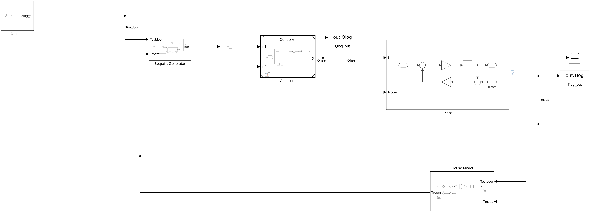
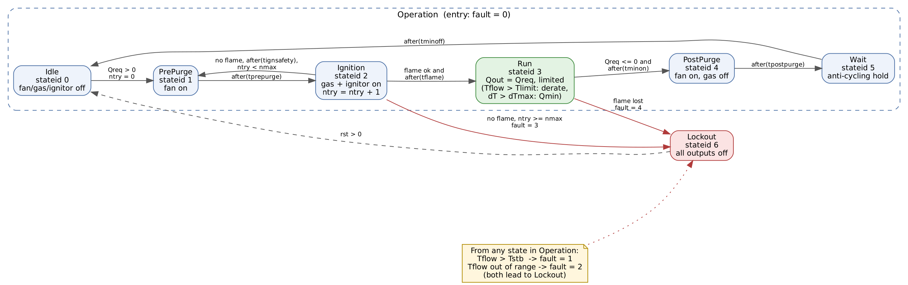

# Combi boiler controller

A Simulink model of the control software of a combi boiler (heating circuit and domestic hot water), built step by step by hand as a learning and portfolio project. The scope is the control software only: controllers, burner modulation, burner sequence and protection (Stateflow), setpoint generation, requirements and tests. No hardware design.

Everything is built by hand in Simulink and Stateflow and verified by automated model-in-the-loop (MIL) tests with traceable requirement IDs (see `requirements/REQUIREMENTS.md`). Assumptions that are not taken from a datasheet are marked as assumptions in the text.



## Repository content

| File | Purpose |
|---|---|
| `init_params.m` | Single parameter file for all models and tests |
| `isitici.slx` | Heating circuit: outdoor temperature, setpoint generator (3 modes), controller, burner sequence chart, burner, thermal plant (two nodes), temperature sensor, house model |
| `Controller.slx` | Heating controller (model reference) |
| `dhwplant.slx` | Domestic hot water: flow-through plant and controller |
| `test_ch_basic.m` | MIL test, heating, REQ-CH-001 ... 004 |
| `test_ch_step.m` | MIL test, heating setpoint step, REQ-CH-005 |
| `test_ch_low.m` | MIL test, heating at low load, REQ-CH-006 ... 008 |
| `test_hc.m` | MIL test, heating curve, REQ-HC-001 ... 004 |
| `test_room.m` | MIL test, room temperature control over 24 h, REQ-RM-001 ... 003 |
| `testdhw.m` | MIL test, domestic hot water, REQ-DHW-001 ... 007 |
| `testburner.m` | MIL test, burner gas interface, REQ-BR-001 ... 002 |
| `testseq.m` | MIL test, burner sequence and protection with fault injection, REQ-BS-001 ... 008 |
| `requirements/REQUIREMENTS.md` | Requirements with IDs |
| `docs/` | Diagram images of the models |

## How to run

Requirements: MATLAB and Simulink with Stateflow (R2026b; the chart in `isitici.slx` needs Stateflow). Everything is typed in the MATLAB Command Window, with the repository folder as the current folder.

```matlab
init_params          % define all parameters in the base workspace
test_ch_basic        % heating, steady setpoint
test_ch_step         % heating, setpoint step
test_ch_low          % heating, low load
test_hc              % heating curve
test_room            % room temperature control, 24 h
testdhw              % domestic hot water
testburner           % burner gas interface
testseq              % burner sequence and protection (fault injection)
```

Each test prints `PASS` or `FAIL` per requirement. The tests call `init_params` themselves and then override the scenario values, so they can be run in any order. After a test, run `init_params` again before simulating a model by hand.

## Design overview

### Signal flow of the heating circuit (`isitici.slx`)

`Outdoor` and `Setpoint Generator` produce the flow temperature setpoint `tset`. A zero-order hold (Ts = 0.1 s) feeds the `Controller`, which requests burner power `Qreq`. The `BurnerSequence` chart decides whether the burner may run and passes `Qreq` through as `Qout` only in state Run. The `Burner` subsystem turns it into gas power `Qgas` and heat power `Qheat`. The `Plant` returns the flow temperature (through the `Sensor`) and the return temperature `Tret`. The `House Model` returns the room temperature `Troom` to the plant and to the setpoint generator.

```
tset -> Controller -> Qreq -> BurnerSequence -> Qout -> Burner -> Qheat -> Plant -> Tflow -> Sensor -> Controller / BurnerSequence
                                  ^  flame, reset            ^ Tret <-----------------+
```

### Plant (two nodes)

The plant has two thermal nodes: the heat exchanger water (`Chx` = 10 kJ/K) and the radiator (`Crad` = 100 kJ/K), connected by a water mass flow `mdot` = 0.25. The radiator emits heat with a power law, `Krad` = 35.2 and exponent `nrad` = 1.3 (the usual radiator exponent for standard radiators; treat the exact values as assumptions and not as measured data). The return temperature `Tret` is an output of the plant and drives the efficiency of the burner.

### Temperature sensor

First order lag (NTC, `tauntc` = 5 s, implemented as a State-Space block so that the initial state is the start temperature `Tamb`) and quantisation (`qntc` = 0.1 K). Controller and burner protection both use the sensor reading, not the true temperature. Consequence: the 5 s lag is visible in the protection timing (see REQ-BS-006).

### Controller

Discrete PI (`Kpch` = 3000, `Kich` = 6, Ts = 0.1 s) with external saturation `Qmin ... Qmax` and tracking anti-windup (`Ktch` = 0.005). The output is a request `Qreq`; whether and how it is executed is decided by the burner sequence. If the required power is below `Qmin`, the request is cycled by a hysteresis relay (off at setpoint + 3 K, on at setpoint - 3 K), and the PI integrator is reset while the request is off.

### Burner (`Burner` subsystem)

Gas power `Qgas = Qreq / etanom` limited to `0 ... Qgasmax` (24.6 kW), with `etanom` = 0.975. Heat power `Qheat = eta(Tret) * Qgas`, where `eta` is a 1-D lookup of the efficiency over the return temperature: 1.02 at 30 °C, 0.975 at 55 °C and 80 °C (end values held). The points at 80 °C and about 30 °C come from typical datasheet values for condensing boilers (80/60 and 50/30 operation); the value at 55 °C is an interpolation assumption.

### Burner sequence and protection (`BurnerSequence`, Stateflow)



The picture is the design diagram of the chart (drawn from the implemented states and transitions; the Stateflow editor itself needs a Stateflow licence to open). The chart runs at Ts = 0.1 s, uses temporal logic (`after(n, sec)`) and has these states:

| State | Behaviour |
|---|---|
| Idle | everything off, waits for `Qreq > 0` |
| PrePurge | fan on for `tprepurge` = 5 s |
| Ignition | gas and ignitor on, flame proving `tflame` = 1 s, at most `nmax` = 3 attempts, each `tignsafety` = 3 s |
| Run | the only state with gas. `Qout = Qreq`, derated above `Tlimit` = 90 °C, reduced to `Qmin` if flow minus return exceeds `dTmax` = 30 K. Runs at least `tminon` = 30 s |
| PostPurge | gas off, fan on for `tpostpurge` = 10 s |
| Wait | anti-cycling hold of `tminoff` = 60 s |
| Lockout | all outputs off until a reset. Outside the `Operation` superstate |

Faults: 1 over-temperature (`Tflow > Tstb` = 95 °C), 2 sensor out of range (`Tsmin` = -20 ... `Tsmax` = 130 °C), 3 ignition failure (three failed attempts), 4 flame lost during Run. The over-temperature and sensor transitions start at the border of the superstate `Operation`, so they act from every state of it ("any state"). The flame signal and the reset are test inputs (Step blocks `tflamefail`, `trst`) and are used for fault injection.

### Setpoint modes (`hcmode`)

The flow temperature setpoint is selected by `hcmode` through a multiport switch:

1. **Fixed setpoint**: a step block (`tsetinit`, `tsetfinal`, `tstep`).
2. **Heating curve**: the flow temperature is looked up from the outdoor temperature (`hcx`, `hcy`, linear interpolation, end values held outside the table) and limited to `Tflowmin ... Tflowmax`. The curve is a feed-forward element.
3. **Room temperature control**: cascade. The curve is the feed-forward part and a slow room PI (`Kpr`, `Kir`, `Ktr`, Ts = 1 s) corrects it from the room temperature error, with tracking anti-windup on the limit.

In mode 2 the room drifts when the house is leakier than the curve assumes. In mode 3 the PI removes most of that error.

### House model and outdoor temperature

`Croom dTroom/dt = UA (T - Troom) - UAh (Troom - Toutdoor)`, `Croom` = 2 MJ/K, `UAh` = 190 W/K (time constant about 2 h). Outdoor temperature: `Toutdoor + Toutamp * sin(2 pi (t - 9 h) / 24 h)`, maximum at 15:00.

### Domestic hot water (`dhwplant.slx`)

- Plant: flow-through heat exchanger, `Cdhw dT/dt = Q - m_dot cp (T - Tin)`, flow-dependent, cold start.
- Burner request: relay with hysteresis on the flow (on at 2.5 L/min, off at 2.0 L/min).
- Controller: PI (Kp = 800, Ki = 110) plus flow-proportional feed-forward, output limited to `Qmin ... Qmax`, tracking anti-windup (Kt = 3).
- Low load: same hysteresis and PI reset as in the heating circuit.
- Solver: fixed-step (ode1, 0.01 s); the controller runs at Ts = 0.1 s. The DHW model does not use the burner sequence yet.

### Minimum modulation

Burner power is either 0 or between `Qmin = Qmax / turndown` and `Qmax` (default turndown 1:10, Qmax = 24 kW).

## Test results (current, all PASS)

| Area | Result |
|---|---|
| Heating, 20 -> 60 °C | inside the +/-1 K band from 365.5 s on (limit 400 s), overshoot -0.04 K (none), steady-state error 0.055 K, power 3.7 ... 24 kW |
| Heating, step 50 -> 65 °C | inside the +/-1 K band 147.3 s after the step (limit 200 s), overshoot 0.16 K, peak power 24 kW |
| Heating, low load (setpoint 35 °C, about 1.1 kW needed) | temperature 31.94 ... 38.00 °C, 3.06 K from the setpoint at most, 5 burner starts in the evaluated hour |
| Heating curve | outdoor -15 / -5 / 0 / +5 °C give 74.95 / 61.95 / 55.45 / 49.05 °C (curve 75.00 / 62.00 / 55.50 / 49.00); -25 °C gives 74.95 °C, limit at 75 °C verified |
| Room control, 24 h, outdoor 5 °C +/- 4 °C, setpoint 21 °C | room 20.84 ... 21.16 °C (max error 0.16 K), 4 burner starts in 24 h |
| Room control, house loss +30 % | max room error 0.45 K |
| Room, curve only (mode 2, for comparison) | max room error 1.97 K (nominal house), 4.63 K (house loss +30 %) |
| DHW, cold start, feed-forward off | 44.9 °C in 35.7 s, no overshoot, 2.15 K dip at the 8 -> 10 L/min flow step |
| DHW, cold start, feed-forward on | 44.9 °C in 18.2 s, overshoot 0.08 K, no dip at the flow step |
| DHW, low load (1.7 kW) | temperature 32 ... 38 °C (setpoint 35 °C), 3 burner starts in 120 s |
| Burner interface | in Run `Qgas = Qreq/etanom` with 0.000 W deviation (19965 samples), no gas outside Run, peak 24.6 kW |
| Start sequence | pre-purge 5.0 s, flame proving 1.0 s |
| Ignition failure | 3 attempts, then lockout, fault 3, no gas |
| Flame loss at 300 s | lockout in the same sample, fault 4, no gas |
| Anti-cycling (narrow hysteresis forces fast cycling) | gas closed at least 75.1 s between burns (limit 60 s), 5 cycles |
| Minimum burn time (`tminon` set to 100 s for the test) | shortest burn 100.0 s over 5 burns |
| Over-temperature (`Tstb` set to 50 °C) | lockout at 58.0 s, fault 1, no gas |
| Sensor range (`Tsmax` set to 40 °C) | lockout at 27.8 s, fault 2, no gas |
| Reset | lockout left in the same sample as the reset (330 s) |

## Known limitations

- **Settling margin of REQ-CH-001:** the flow temperature is inside the +/-1 K band after 365.5 s against a limit of 400 s (margin about 35 s). The time includes the 6 s start sequence and a slow tail of the PI controller. The original "first time at 59.9 °C" criterion is not used: it was 929.7 s, because the sensor lag and quantisation make the reading touch 59.9 °C late. It is printed as information only.
- **Steady-state error and quantisation:** REQ-CH-003 passes with 0.055 K against 0.1 K; the sensor resolution is 0.1 K, so the limit cannot be tightened much.
- **Start sequence delay:** a request is executed after about 6 s (pre-purge and flame proving). The PI keeps integrating during the start sequence and the Wait state (no windup handling for the sequence yet).
- **Protection uses the sensor reading:** the over-temperature limit sees the temperature with the 5 s lag of the sensor (lockout at 58.0 s although the true temperature crossed 50 °C at about 52.7 s). A real safety limiter would use an independent sensor.
- **The reset is a level, not a pulse:** in the test the `rst` signal stays 1 after 330 s, so a new lockout would be reset immediately. A real reset must be edge-triggered with a limited number of resets.
- **Flame signal and reset are test inputs:** there is no flame sensor model. Faults are injected by Step blocks.
- **Not implemented:** pump overrun (`tpumpoverrun` exists in `init_params.m` but is not used), frost protection, user shift on the heating curve, mode manager, rate limiter on the power request.
- **Stateflow trial:** the chart was built with a trial licence; the picture in `docs/burner_sequence.png` is the design diagram of the chart.
- Robustness against +/-30 % radiator parameters is not verified yet (only +30 % `UAh` of the house is, in `test_room.m`).
- DHW: no flow sensor error or noise model, no transport delay, no preheat mode. The PI is tuned for 8 L/min; at very low flow the cold-start overshoot reaches about 3 K (gain scheduling is planned).
- The outdoor temperature is a single sine per day; the room model has one lumped capacity and no solar or internal gains.
- Plant and house parameters are lumped estimates and not measured on real hardware.

## Planned

C++ implementation of the controller and the sequence with unit tests and back-to-back comparison against the model, static analysis and continuous integration; pump overrun and frost protection; user shift on the heating curve; burner request state machine for the DHW path.
